# 泰坦尼克号（简单的MLP）

## 一，数据清洗和特征处理方法

 ### 1. 数据清洗中舍弃了 ：  
- Name：直观上对存货状况没有影响

- Ticket： 字符串在本模型里难以直接转化为可用的特征数据（类别非常多）。但有存在影响的可能，比如字符串中有某些乘客购票时的隐藏信息，如：价格，港口等，但探究其内在过于复杂，故舍去。

- Cabin：缺失值太多，难以用上，如果我代码能力够的话，可以先写一个预测器用其他已知特征来预测它进而填补缺失，但那太复杂了。
### 2. 特征处理方法：
- 新特征：在程序里我并没添加新特征（事实上可以添加的有家眷数Family=SibSp+Parch，意识到这点时是我在回答这题的时候，此时完整代码已经写完了。。。）
- 填补缺失值：使用了中位数填补了Age，fare
    ，这是最简便的方法，不用像使用平均值一样担心受极端值影响，而且比插入法简单的多；使用了众数填补了Embarked，因为这是个类别特征，用众数方便快捷。
- 使用独热编码转换了类别特征Embarked
- 标准化：对数字型数据进行标准化处理
## 二，模型结构、损失函数、优化器及主要超参数

### 1. 模型结构：单层全连接神经网络。
- 输入特征维度为 7，输出维度为 2（分别对应遇难和存活的概率）
- 计算公式为 
​$$ \hat{y}=softmax(XW+b)$$

### 2. 损失函数：使用交叉熵作为损失函数，并且为了防止出现log 0的情况增加了一个极小值

### 3. 优化器：
- 使用反向传播时计算梯度，再使用梯度下降法计算梯度

### 4. 主要超参数：

 - 学习率（Ir）：0.1

- 批大小（batch_size）：64

- 训练轮数（epochs）：64

## 三，数据划分方式、随机种子和实验配置

### 1. 数据划分方式：
- 使用函数train_test_split（）将数据集的80%划分为训练集，20%划分为测试集

### 2. 全局随机种子：42

### 3. 实验配置：
   - python:3.14.5
- 框架：pytorch2.14.0
    实验环境配置如表 4-1 所示：

表 4-1 实验环境配置

| 名称 | 配置信息 |
| :--- | :---: |
| 操作系统 | windows 11 |
| 开发语言 | Python 3.14.5 |
| 框架 | Pytorch 1.10.0 + cuda 11.1 |
| CPU | Intel(R) Core(TM) Ultra 7 251HX (2.90 GHz) ||
| 内存 | 16G |

---
## 四，训练过程中遇到的问题及解决方法

### 1. 遇到的困难
（实在是太多了，这里列个几条和解决方法）
- 读取数据时格式不对:后面我已经不止几次遇到过数据集在调用函数运算时运算时因为类型错误而报错的时候了，这是最烦人的一点，到后面预测新成员时这点还在追我（我输入的是字典还得转换为df表格），还有精度不同而导致的报错，算矩阵乘法是还得提前改一下二者精度。以及矩阵或数组的形状不对，但这一点就数不清坑杀我多少次。就比如这几块部分
    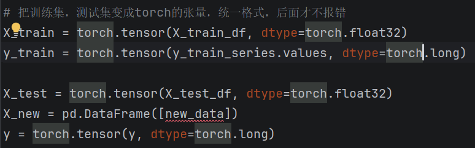
    没加的时候后面傻傻地直接算全是错误

- 填补缺失值：这个开始想自己写一个函数来实现，真的是稍微有点复杂，不过后面查资料的时候突然找到神秘的函数可以直接帮我完成这项任务当即就拿来用了
就是这个`fillna()`

- 绘图：本来想写一个函数可以同时在绘制两张图时调用，但是后面发现bug如山就分别写了一个。

- 划分数据集时顺序错误：开始时我是先标准化了所有数据再划分，后面查bug时AI提醒我不能这样做，会造成数据泄露，于是调整了二者顺序。（写了一堆叠在一起的代码，虽然不美观，但还是完成任务了）
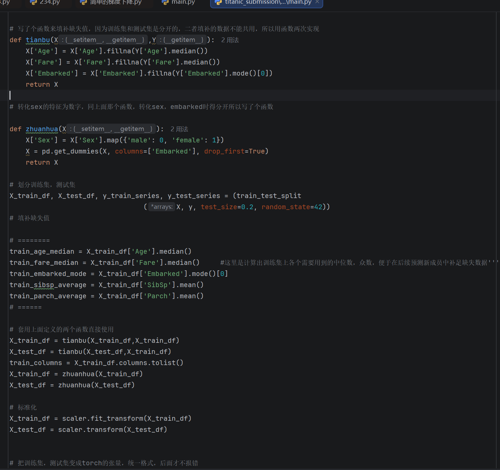

- 预测函数：太容易在面临用户输入格式错误，数据不对直接报错的风险，开始直接写了个try直接不管了，写的会报错就重输！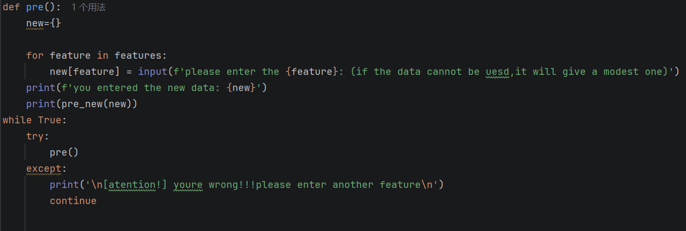

不过这样太随意了，
后面改写了函数好多次，最后终于写成了能把输入为空的，格式不对的值弄成默认值的函数（不过年龄还是可以为负，配偶数可以不为自然数。。。）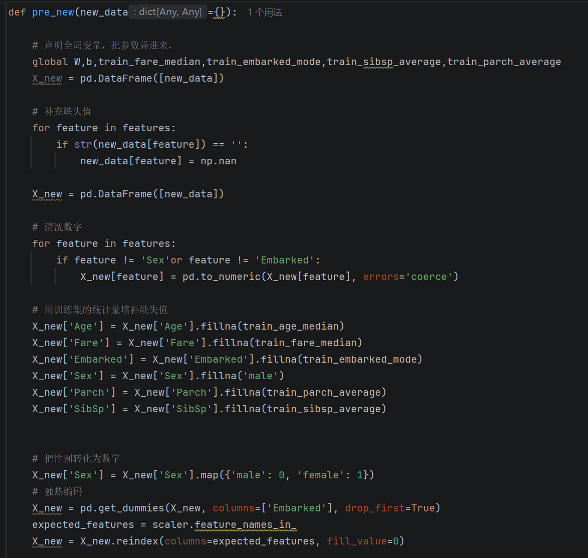

## 五，测试集准确率、实验结果分析和心得体会。

### 1. 测试集准确率：
    **79.32%**（保留小数后两位）

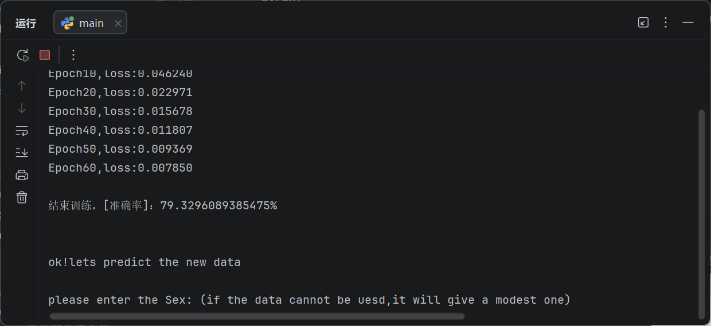

### 2. 实验结果分析：
- 准确率：79.32%并不算很高，其重要原因是因为使用softmax回归进行分类任务本质上还是在使用线性模型，其学习精度有限（不如多层神经网络）但也可以在一定范围内给出新成员的一个较为准确的预测结果。
- 损失函数的变化
    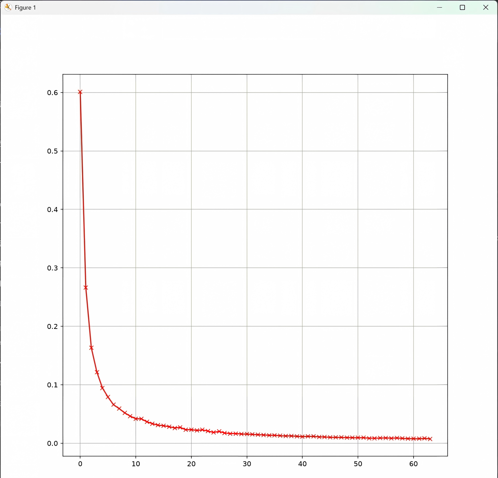
    如图可以看到损失值在变小的，说明模型正在逐步学习，而且收敛良好，没有明显震荡
- 测试集训练集准确率对比
    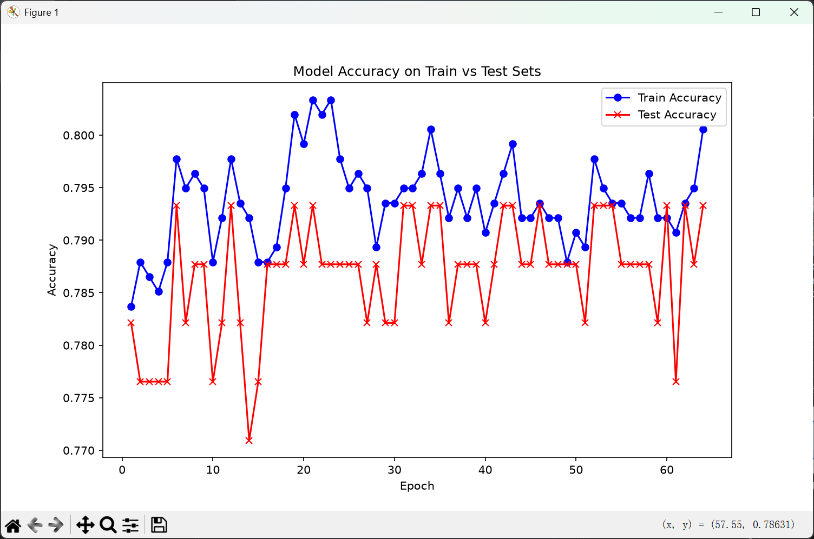
    如图可以看到模型在训练集，测试集上准确率并没有太大差别，说明模型泛化性能还行，没有过拟合。
### 3. 心得体会
- 写代码是真不容易啊。跑一次代码，要想没bug，头发都得抓没（原来这就是程序猿发量的秘密）写之前充满激情，写这段话时已经双目无神了。。。怎么到处是要改的地方啊，写道没有报错后突然又发现好像有几个逻辑出错了，顺序得改一下，真的有点崩溃，然后又是报错。（不得不说AI在找bug能力方面真的独树一帜，只是让AI找到了远不如自己改完之后没问题有成就感，但也是真的费眼睛和头发）

- 其实，自己从0开始写一个程序还是非常有成就感的，看到自己程序在自己的调试下终于不报错，能运行了，真的很激动，尤其是当绘制的图片出现的时候，难掩激动。现在虽然这个模型还不完美（精度不够，没有构造新特征，预测时的输入方式有限制）但每次看到它能正常运行就感觉像看到自己的孩子终于表现得像了个人一样（这是个什么鬼比喻），至少成功运行了。

- 尤其感觉到ml之路任重而道远，这才第一题，就已经花费我不少时间（足足两天），而且我已处于背水一战的境地了--在此之前没有开展ml有关的任何进一步学习工作，简而言之就是玩了好几周，现在抓头一看没时间了[哭]，所以只能发奋图强，到笔试截至期间订下契约：不能再被手机，电脑所控制。（不刷视频，打游戏）以弥补我的懒惰，争取在最后冲刺阶段完成笔试基本要求（虽然有点渺茫）就先写到这了，接下来还要看卷积呢。。。
（已经2天没刷手机了。。。）

---
### 4.杂念
（先写的这里，然后发现学习笔记有要求，于是就把原来的拆开了）
1. 看的书：首先是这本，在代码里跑的模型用到的回归就是里面分类问题里第一个用来解决分类问题的softmax
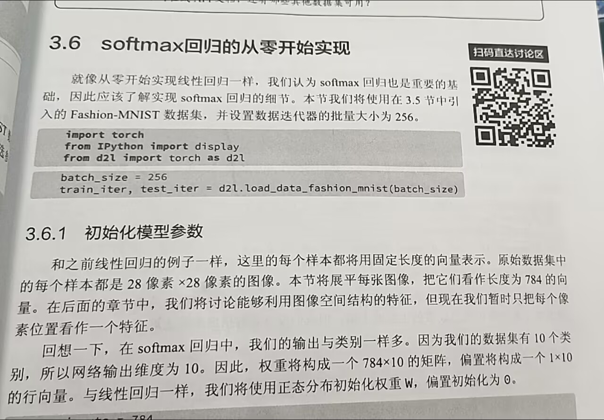

2. 感受:
    - 第一次直接看书里的代码时感觉自己可以写得游刃有余，即使有很多不懂的代码，函数，例（作为一个编程小白真的很悲哀）但是通过直接问AI，用搜索引擎几乎很快都能理解它的作用。
    这让我充满了信心。
    - 刚开始尝试的那几段图片没有留下来，但总之就是不仅写的慢，而且bug多，本以为几个小时内就能完成任务的事结果面对的是一堆程序报错的红色。。。打完半天代码发现自己还在第一步（总算是不报错了）

        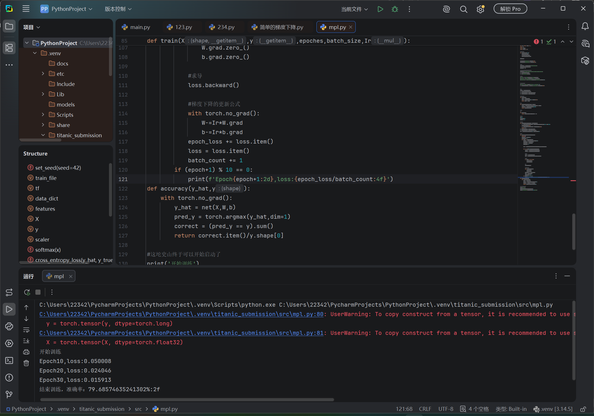
        （红色的忽略它）
        然而按照要求还有许多要写的，比如：（绘制两张图，可以预测新成员，）
    - 后面接着改，先是没啥bug
    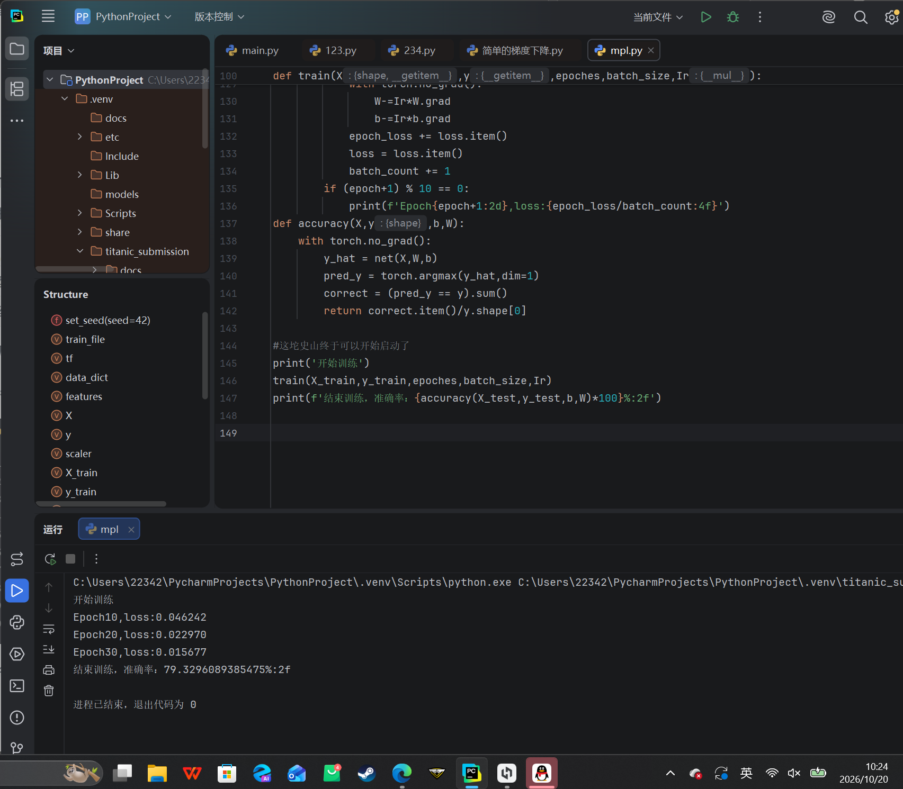
    然后慢慢加东西以求完成要求
    - 当图像在我眼前的时候真的很激动，终于成功了！

虽然准确率看起来没那么高，但毕竟我用的是比较简单的线性模型嘛。。。
也能进行新成员预测了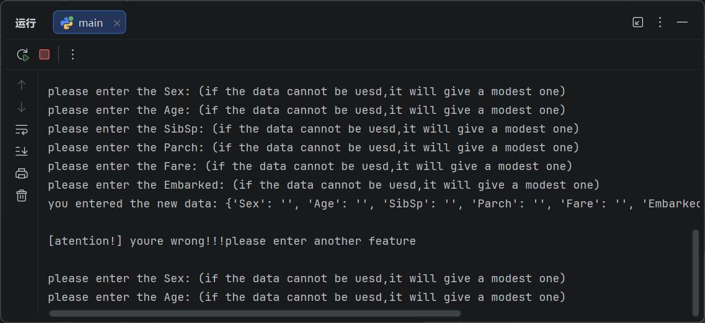